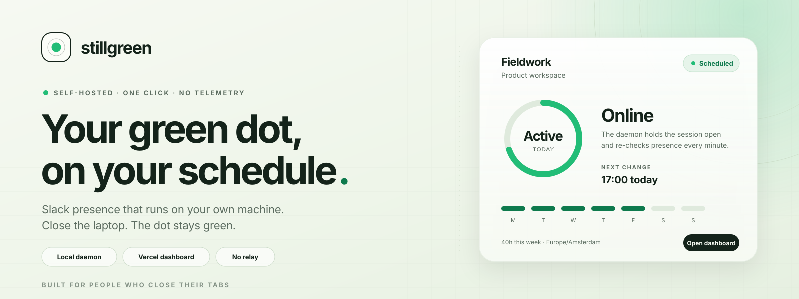
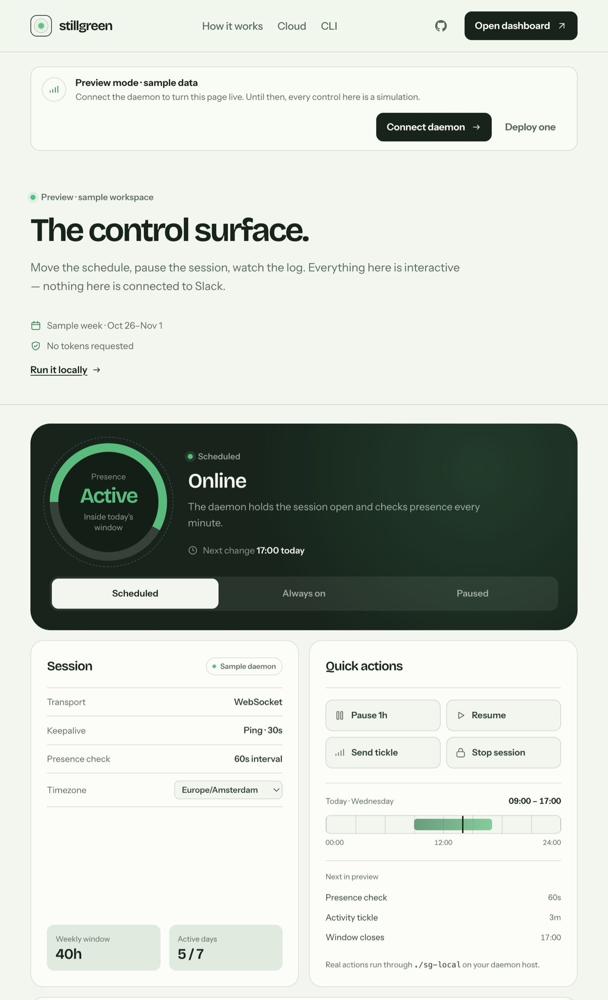
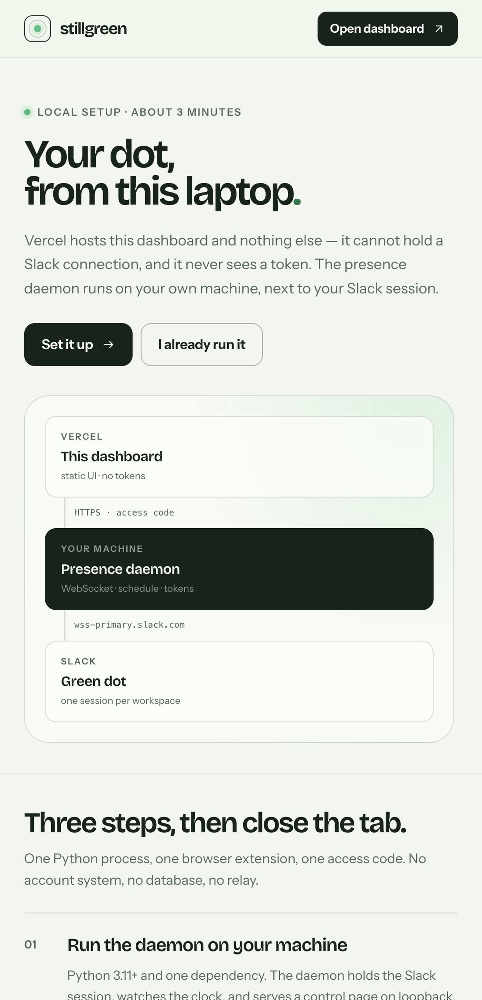
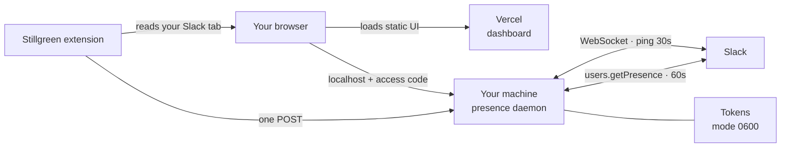

<p align="center">
  <a href="https://github.com/laxmideepak/slack">
    
  </a>
</p>

<h2 align="center">Slack presence that runs on your own machine.</h2>

<p align="center">
  A personal presence daemon, a static dashboard, and a small extension that<br>
  captures your Slack session in one click. No account, no relay, no telemetry.
</p>

<p align="center">
  <a href="https://stillgreen.vercel.app"></a>
  <a href="https://github.com/laxmideepak/slack/stargazers"></a>
  <a href="https://nextjs.org"></a>
  <a href="https://www.python.org"></a>
  <a href="#security-model"></a>
</p>

<p align="center">
  <a href="https://stillgreen.vercel.app/dashboard"><strong>Live dashboard</strong></a> ·
  <a href="#product-tour"><strong>Product tour</strong></a> ·
  <a href="#how-it-works"><strong>How it works</strong></a> ·
  <a href="#install"><strong>Install</strong></a> ·
  <a href="#the-extension"><strong>Extension</strong></a> ·
  <a href="#security-model"><strong>Security</strong></a> ·
  <a href="#cli-reference"><strong>CLI</strong></a>
</p>

---

> [!IMPORTANT]
> **Three pieces, one system.** Vercel hosts a static dashboard and nothing else — it cannot hold a Slack connection and never sees a token. The presence daemon runs on your machine and keeps the session alive. A small bundled extension reads your already-signed-in Slack tab and hands the two values to that daemon.

## The short version

<table>
  <tr>
    <td width="25%" valign="top">
      <h3>As on as you are</h3>
      <p>One Python process holds the Slack session, pings every 30 seconds, and reconnects the moment presence drops.</p>
    </td>
    <td width="25%" valign="top">
      <h3>On your schedule</h3>
      <p>Weekly windows, global or per-workspace pause, and temporary stay-online overrides. Manual “away” is never overridden.</p>
    </td>
    <td width="25%" valign="top">
      <h3>One-click capture</h3>
      <p>The extension reads the <code>xoxc</code> token and the <code>HttpOnly</code> <code>d</code> cookie from your own browser. No DevTools, no copy-paste.</p>
    </td>
    <td width="25%" valign="top">
      <h3>No middleman</h3>
      <p>No Stillgreen account, no relay, no analytics. Tokens stay on your disk; traffic goes to Slack.</p>
    </td>
  </tr>
</table>

## Product tour

<table>
  <tr>
    <td width="50%" valign="top">
      
      <p align="center"><sub><strong>Dashboard</strong> — live when paired, explicit sample otherwise.</sub></p>
    </td>
    <td width="50%" valign="top">
      
      <p align="center"><sub><strong>Setup</strong> — run the daemon, capture, connect.</sub></p>
    </td>
  </tr>
</table>

## Why Stillgreen

Most presence tools ask you to hand a third-party service a Slack session cookie and trust its uptime, its pricing, and its promises. Stillgreen takes the opposite route:

- **A daemon, not a subscription.** One process on a machine you already own.
- **No relay in the middle.** Your browser talks straight to `127.0.0.1` with an access code.
- **No tokens on Vercel.** The hosted UI has no server-side secret to leak and no API route to abuse.
- **No silent behavior.** It never overrides a manual away status, and the dashboard is explicit about preview vs. live.
- **No lock-in.** Plain Python and a static site. Stop it whenever you want.

## How it works



- The extension reads `localStorage.localConfig_v2` (falling back to `window.boot_data`) for the `xoxc` token, and the `d` cookie through the `cookies` permission — the only way to reach an `HttpOnly` cookie.
- It posts both values to `http://127.0.0.1:8765/api/workspaces` with your access code. Nowhere else.
- The daemon connects to `wss-primary.slack.com` the way the Slack web client does, sends a JSON `ping` every 30 seconds, and a simulated activity `tickle` every 5 minutes.
- It checks `users.getPresence` every 60 seconds and reconnects if Slack marks you away. It **never** overrides a manual “away”.
- The dashboard receives only token-free state: schedule, session health, workspace names, and activity.

## Install

Three steps, about three minutes. You need Python 3.11+, Chrome, and a Slack workspace you own.

### 1. Run the daemon

```sh
git clone https://github.com/laxmideepak/slack.git
cd slack
./sg-local web --daemon --open
```

The control surface opens at `http://127.0.0.1:8765`. Keep it running; `./sg-local install-launchd` starts it at login on macOS.

### 2. Capture your Slack session

1. Open `chrome://extensions`, enable **Developer mode**, and choose **Load unpacked** → select the `extension/` folder in this repository.
2. Open the extension, set the daemon URL to `http://127.0.0.1:8765`, and paste the access code (`./sg-local web --show-code`).
3. Sign in at <https://app.slack.com> in the same browser, then press **Capture from Slack**.

Every workspace signed in to that tab is added in one pass.

### 3. Connect the dashboard

Open <https://stillgreen.vercel.app/dashboard>, choose **Connect daemon**, and enter the same URL and code. The dashboard goes live. Your browser stores both values in `localStorage`; they are never sent to Vercel.

### Prefer no extension?

The manual path still works — the daemon accepts a pasted header, cookie string, or full WebSocket URL and extracts the value:

<details>
<summary><strong>Show the manual token walkthrough</strong></summary>

<br />

1. Open your workspace at <https://app.slack.com> and sign in.
2. Open DevTools (`Cmd+Option+I`), select **Network**, and reload the tab.
3. Find the `xoxc` token: filter by `api`, open a request such as `client.boot` or `users.getPresence`, and inspect **Payload → Form Data** for `token`. Or filter by `WS`, open `wss-primary.slack.com`, and copy `token=xoxc-...` from the request URL.
4. Open **Application → Cookies → https://app.slack.com** and copy the cookie named `d`. It starts with `xoxd-`. It is `HttpOnly`, so `document.cookie` will not show it.

Both values must come from the same signed-in browser session. Treat them like passwords: never paste them into chat, issues, or shell history. The daemon reads them with hidden input.

</details>

## The extension

`extension/` is a Manifest V3 extension of roughly 300 lines, with no build step and no dependencies.

| Permission | Used for |
| --- | --- |
| `cookies` | Read the `d` cookie for `slack.com`. Nothing else. |
| `scripting` | Run one function in the Slack tab to read its `localStorage`. |
| `tabs` | Find an open Slack tab. |
| `storage` | Remember the daemon URL and access code. |
| `https://*.slack.com/*` | The capture itself. |
| `http://127.0.0.1/*`, `http://localhost/*` | Talking to your daemon. |

It does not store the token, run in the background, load remote code, or contact any host other than the daemon you enter. Set `SG_LOCAL_ALLOW_EXTENSIONS=0` on the daemon to refuse all extension origins.

## Dashboard

| State | What you see |
| --- | --- |
| **Paired** | Live session health, schedule, pause/resume, stay-online, per-workspace controls, and activity |
| **Unpaired** | A labeled sample preview with a **Connect daemon** action |
| **Unreachable** | The saved daemon is shown with an error and a path to update the URL or code |

The dashboard polls the daemon every few seconds. Mutations go straight to the daemon over loopback. Chrome treats `127.0.0.1` as a trustworthy origin, so an HTTPS page may call it directly.

## Security model

| Data | Where it lives | Who can read it |
| --- | --- | --- |
| Slack `xoxc` + `xoxd` | `config.json` on your disk, mode `0600` | You and the daemon process |
| Bridge code | `bridge.json` (`0600`) or `SG_LOCAL_BRIDGE_CODE` | You and the daemon |
| Daemon URL + code | Browser `localStorage` and extension `chrome.storage` | That browser profile |
| Presence events | Daemon logs | You |
| Dashboard assets | Vercel | Public |

- Token values are **never** returned by the API, written to logs, or included in errors.
- The control surface requires the bridge code on every state and mutation request, and binds to loopback only.
- CORS is an allowlist: `*.vercel.app`, loopback, and extension origins. Each can be disabled — `SG_LOCAL_ALLOW_VERCEL=0`, `SG_LOCAL_ALLOW_EXTENSIONS=0`.
- Revoking access is equivalent to signing out of Slack or changing your password. If Slack rejects the tokens, capture them again.

## CLI reference

| Command | Purpose |
| --- | --- |
| `sg-local add` | Add or update a workspace with hidden token prompts |
| `sg-local list` | List workspaces and live status |
| `sg-local remove NAME` | Remove a workspace |
| `sg-local start` / `stop` / `restart` | Control the background daemon |
| `sg-local status` | Daemon, schedule, pause, and workspace status |
| `sg-local schedule set --days mon-fri --start 09:00 --end 17:00` | Set a weekly window |
| `sg-local schedule always` | Keep presence on all the time |
| `sg-local pause --for 2h` | Pause everything temporarily |
| `sg-local pause --workspace NAME` | Pause one workspace |
| `sg-local resume` | Clear global and per-workspace pauses |
| `sg-local stay 90m` | Stay online temporarily, overriding pause/schedule |
| `sg-local web --daemon --open` | Run the control surface |
| `sg-local web --show-code` | Print the access code |
| `sg-local doctor --check-tokens` | Check config, permissions, and token validity |
| `sg-local logs -f` | Follow daemon logs |
| `sg-local install-launchd` | Start at macOS login |

<details>
<summary><strong>Schedule examples</strong></summary>

<br />

```sh
# Weekdays, 9am to 5pm in the machine's timezone
sg-local schedule set --days weekdays --start 09:00 --end 17:00

# Weekdays in New York, even if the host is elsewhere
sg-local schedule set --days mon-fri --start 09:00 --end 17:00 --timezone America/New_York

# Overnight window: Monday 22:00 through Tuesday 06:00
sg-local schedule set --days monday --start 22:00 --end 06:00 --timezone local

# Split days and weekends
sg-local schedule set --days mon,wed,fri --start 08:30 --end 18:00
sg-local schedule set --days weekends --start 10:00 --end 14:00
```

An overnight window belongs to the day it starts. `--timezone local` uses the host’s current timezone; any IANA name also works.

</details>

## Deploying the dashboard

The dashboard is a static Next.js export of five routes with no server logic. Import <https://github.com/laxmideepak/slack> at <https://vercel.com/new>, keep the repository root as the root directory, and deploy. No environment variables, no database, no build settings.

`.vercelignore` keeps the daemon, its tests, and the extension out of the upload. The live instance is at <https://stillgreen.vercel.app>.

## Development

```sh
# Python daemon — 66 tests, no network
python3 -m pytest -q

# Web interface
npm install
npm run build
npm run dev

# Extension — no build step, load the folder directly
# chrome://extensions → Developer mode → Load unpacked → extension/
```

```text
app/                  Next.js App Router pages and global styles
components/           landing, live dashboard, connect dialog, guides
lib/                  typed daemon client and localStorage pairing
extension/            Manifest V3 capture extension
sg_local/
  cli.py              command-line interface
  config.py           paths, schema, permissions, pause/stay helpers
  daemon.py           supervisor and schedule reconciliation
  schedule.py         weekly schedule parsing and evaluation
  slack.py            Slack HTTP client and presence WebSocket
  state.py            PID/lock handling, runtime state, log tailing
  web.py              control surface, bridge auth, API
tests/                Python unit tests (no network)
docs/                 launch banner and product screenshots
```

## Status

**Working today:** presence daemon, weekly schedules, global and per-workspace pause, stay-online overrides, multi-workspace support, the local control surface, the capture extension, dashboard pairing, and 66 passing unit tests.

**Not shipped:** a managed service, and a Firefox build of the extension. The dashboard stays an explicit preview until you connect a daemon — there is no sample data pretending to be live.

## Contributing

This is a personal project, but issues and focused pull requests are welcome. Please never include real Slack tokens, cookies, workspace names, or account email in an issue. Use the fake values from the test suite when demonstrating a problem.

## Disclaimer

Stillgreen is an independent project. It is not affiliated with Slack or [slack.green](https://slack.green).

Automating presence may violate your employer’s policy or Slack’s terms. Use it only on workspaces you own or have explicit permission to use.

<div align="center">
  <br />
  <sub>Built for people who close their tabs.</sub>
</div>
