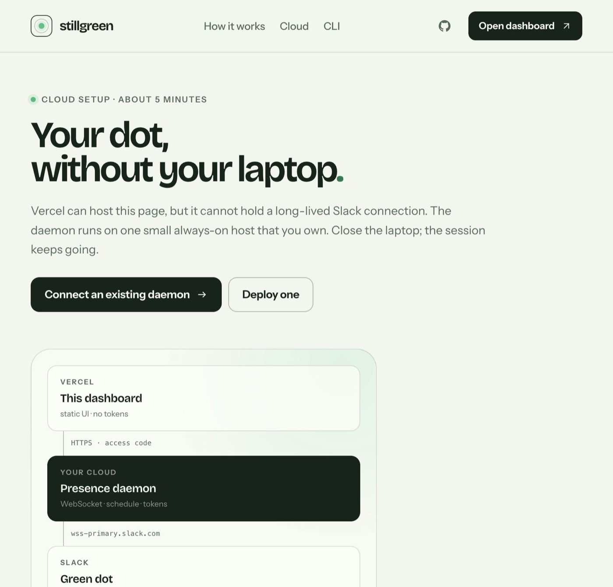
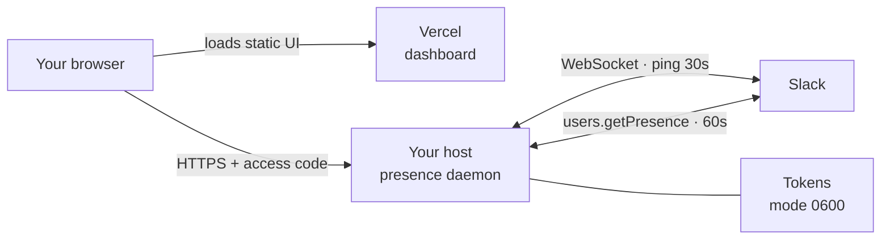

<p align="center">
  <a href="https://github.com/laxmideepak/slack">
    
  </a>
</p>

<h2 align="center">Slack presence that runs on your own cloud.</h2>

<p align="center">
  A personal, self-hosted presence daemon with an editorial dashboard.<br>
  Close the laptop. The dot stays green.
</p>

<p align="center">
  <a href="https://github.com/laxmideepak/slack/stargazers"></a>
  <a href="https://nextjs.org"></a>
  <a href="https://www.python.org"></a>
  <a href="https://www.docker.com"></a>
  <a href="#security-model"></a>
</p>

<p align="center">
  <a href="#product-tour"><strong>Product tour</strong></a> ·
  <a href="#how-it-works"><strong>How it works</strong></a> ·
  <a href="#cloud-setup-recommended"><strong>Cloud setup</strong></a> ·
  <a href="#local-setup"><strong>Local setup</strong></a> ·
  <a href="#security-model"><strong>Security</strong></a> ·
  <a href="#cli-reference"><strong>CLI</strong></a>
</p>

---

> [!IMPORTANT]
> **Two pieces, one system.** Vercel hosts the dashboard. An always-on host runs the daemon. The dashboard is frontend-only and never receives Slack tokens — those live on the daemon with file mode `0600`.

## The short version

<table>
  <tr>
    <td width="25%" valign="top">
      <h3>Always on</h3>
      <p>One small Python process holds the Slack session, pings every 30 seconds, and reconnects when presence drops.</p>
    </td>
    <td width="25%" valign="top">
      <h3>On your schedule</h3>
      <p>Weekly windows, global or per-workspace pause, and temporary stay-online overrides. Manual “away” is never overridden.</p>
    </td>
    <td width="25%" valign="top">
      <h3>Honest dashboard</h3>
      <p>Paired to a daemon, it is live. Unpaired, it says so and stays an explicit sample. No pretend controls.</p>
    </td>
    <td width="25%" valign="top">
      <h3>No middleman</h3>
      <p>No Stillgreen account, no relay, no analytics. Tokens stay on your host; traffic goes to Slack.</p>
    </td>
  </tr>
</table>

## Product tour

<table>
  <tr>
    <td width="50%" valign="top">
      
      <p align="center"><sub><strong>Dashboard</strong> — live when paired, explicit sample otherwise.</sub></p>
    </td>
    <td width="50%" valign="top">
      
      <p align="center"><sub><strong>Cloud setup</strong> — deploy the daemon, add tokens, pair the UI.</sub></p>
    </td>
  </tr>
</table>

## Why Stillgreen

Most presence tools ask you to hand a third-party service a Slack session cookie and trust its uptime, its pricing, and its promises. Stillgreen takes the opposite route:

- **A daemon, not a subscription.** You run one process on a host you already own.
- **No relay in the middle.** Your browser talks directly to your daemon over HTTPS with an access code.
- **No tokens on Vercel.** The hosted UI never asks for Slack credentials and has no server-side secret to leak.
- **No silent behavior.** It never overrides a manual away status, and the dashboard is explicit about preview vs. live.
- **No lock-in.** The same CLI runs on a laptop, a VPS, or a container platform. Stop it whenever you want.

## How it works



- The daemon connects to `wss-primary.slack.com` the way the Slack web client does.
- It sends a JSON `ping` every 30 seconds and a simulated activity `tickle` every 5 minutes.
- It checks `users.getPresence` every 60 seconds and reconnects if Slack marks you away.
- It **never** overrides a manual “away”.
- The dashboard receives only token-free state: schedule, session health, workspace names, and activity.

## Cloud setup (recommended)

Three steps, about five minutes. You need a Vercel account and one always-on host.

### 1. Deploy the dashboard to Vercel

Import <https://github.com/laxmideepak/slack> at <https://vercel.com/new>. Keep the repository root as the root directory; Vercel detects Next.js automatically. No environment variables or database are required.

### 2. Deploy the daemon

Use the shipped configuration for Fly.io, Render, Railway, or any Docker host.

**Fly.io**

```sh
fly launch --copy-config --name stillgreen-you --no-deploy
fly volumes create stillgreen_data --size 1 --region ams
fly secrets set \
  SG_LOCAL_BRIDGE_CODE="SG-$(openssl rand -hex 8)" \
  SG_LOCAL_WEB_ORIGIN="https://your-app.vercel.app"
fly deploy
```

**Docker**

```sh
export SG_LOCAL_BRIDGE_CODE="SG-$(openssl rand -hex 8)"
export SG_LOCAL_WEB_ORIGIN="https://your-app.vercel.app"
docker compose up -d --build
```

Put the container behind Caddy, nginx, or your platform’s TLS proxy. The daemon speaks plain HTTP internally; HTTPS is mandatory at the edge.

| Variable | Purpose |
| --- | --- |
| `SG_LOCAL_BRIDGE_CODE` | Access code required by every dashboard request |
| `SG_LOCAL_WEB_ORIGIN` | Comma-separated dashboard origins allowed by CORS |
| `SG_LOCAL_CONFIG_DIR` | Persistent directory for `config.json` and `bridge.json` |
| `SG_LOCAL_STATE_DIR` | Persistent directory for the PID file and logs |
| `PORT` | Supplied by Render/Railway; do not override it |

### 3. Add the workspace and pair the dashboard

1. Open `https://your-daemon-host/` and enter the bridge code.
2. Add the workspace on the daemon page with your `xoxc` token and `xoxd` cookie.
3. In the Vercel dashboard, choose **Connect daemon**, then enter the daemon URL and the same code.
4. Confirm health at `https://your-daemon-host/api/health`.

The URL and access code are stored in your browser’s `localStorage`. They are never sent to Vercel.

## Local setup

```sh
git clone https://github.com/laxmideepak/slack.git
cd slack
python3 -m pip install --user "websockets>=12"

./sg-local add          # hidden prompts for xoxc + xoxd
./sg-local start
./sg-local web --daemon --open
```

The local control page runs at `http://127.0.0.1:8765`. To pair the hosted dashboard with it:

```sh
./sg-local web --show-code
```

Then connect the dashboard to `http://127.0.0.1:8765` with that code. A laptop daemon stops when the machine sleeps — use a cloud host for 24/7 presence.

### Getting the two Slack values

Use the Slack **web app** in a desktop browser, not the desktop app.

<details>
<summary><strong>Show the token walkthrough</strong></summary>

<br />

1. Open your workspace at <https://app.slack.com> and sign in.
2. Open DevTools (`Cmd+Option+I` on macOS), select **Network**, and reload the tab.
3. Find the `xoxc` token:
   - Filter by `api`, open a request such as `client.boot` or `users.getPresence`, and inspect **Payload → Form Data** for `token`.
   - Or filter by `WS`, open `wss-primary.slack.com`, and copy `token=xoxc-...` from the request URL. Stop at the next `&`.
   - On older Slack builds, `JSON.parse(localStorage.localConfig_v2).teams` may still work. If it is empty, use the Network tab.
4. Open **Application → Cookies → https://app.slack.com** and copy the cookie named `d`. It starts with `xoxd-`. It is `HttpOnly`, so `document.cookie` will not show it.

Both values must come from the same signed-in browser session. Treat them like passwords: never paste them into chat, issues, or shell history. The daemon reads them with hidden input.

</details>

## Dashboard

| State | What you see |
| --- | --- |
| **Paired** | Live session health, schedule, pause/resume, stay-online, per-workspace controls, and activity |
| **Unpaired** | A labeled sample preview with a **Connect daemon** action |
| **Unreachable** | The saved daemon is shown with an error and a path to update the URL or code |

The dashboard polls the daemon every few seconds. Mutations go straight to the daemon over HTTPS. There is no Vercel API route and no server-side proxy.

## Security model

| Data | Where it lives | Who can read it |
| --- | --- | --- |
| Slack `xoxc` + `xoxd` | Daemon volume, `config.json`, mode `0600` | You and the daemon process |
| Bridge code | `bridge.json` (`0600`) or `SG_LOCAL_BRIDGE_CODE` | You and the daemon |
| Daemon URL + code | Browser `localStorage` | That browser profile |
| Presence events | Daemon logs | You |
| Dashboard assets | Vercel | Public |

- Token values are **never** returned by the API, written to logs, or included in errors.
- The control surface requires the bridge code on every state and mutation request.
- CORS is an allowlist; `*.vercel.app` and loopback are allowed by default. Set `SG_LOCAL_ALLOW_VERCEL=0` to disable the Vercel wildcard.
- In cloud mode the daemon binds `0.0.0.0` behind the platform TLS proxy. Never expose port `8765` directly to the internet.
- Revoking access is equivalent to signing out of Slack or changing your password. If Slack rejects the tokens, run `sg-local add` again.

## CLI reference

| Command | Purpose |
| --- | --- |
| `sg-local add` | Add or update a workspace with hidden token prompts |
| `sg-local list` | List workspaces and live status |
| `sg-local remove NAME` | Remove a workspace |
| `sg-local start` / `stop` / `restart` | Control the background daemon |
| `sg-local status` | Daemon, schedule, pause, and workspace status |
| `sg-local schedule set --days mon-fri --start 09:00 --end 17:00` | Set a weekly window |
| `sg-local schedule always` | Keep presence on all the time |
| `sg-local pause --for 2h` | Pause everything temporarily |
| `sg-local pause --workspace NAME` | Pause one workspace |
| `sg-local resume` | Clear global and per-workspace pauses |
| `sg-local stay 90m` | Stay online temporarily, overriding pause/schedule |
| `sg-local web --daemon --open` | Run the local control surface |
| `sg-local cloud` | Run the daemon and control surface on `0.0.0.0:$PORT` |
| `sg-local doctor --check-tokens` | Check config, permissions, and token validity |
| `sg-local logs -f` | Follow daemon logs |
| `sg-local install-launchd` | Start at macOS login |

<details>
<summary><strong>Schedule examples</strong></summary>

<br />

```sh
# Weekdays, 9am to 5pm in the machine's timezone
sg-local schedule set --days weekdays --start 09:00 --end 17:00

# Weekdays in New York, even if the host is elsewhere
sg-local schedule set --days mon-fri --start 09:00 --end 17:00 --timezone America/New_York

# Overnight window: Monday 22:00 through Tuesday 06:00
sg-local schedule set --days monday --start 22:00 --end 06:00 --timezone local

# Split days and weekends
sg-local schedule set --days mon,wed,fri --start 08:30 --end 18:00
sg-local schedule set --days weekends --start 10:00 --end 14:00
```

An overnight window belongs to the day it starts. `--timezone local` uses the host’s current timezone; any IANA name also works.

</details>

## Deploy anywhere

| Host | Files | Notes |
| --- | --- | --- |
| Vercel | `package.json`, `app/` | Dashboard only; no daemon, no tokens |
| Fly.io | `fly.toml` | Create the `stillgreen_data` volume first |
| Render | `render.yaml` | Starter plan or higher for a persistent disk |
| Railway | `railway.json` | Mount a volume at `/data` |
| Docker / VPS | `Dockerfile`, `docker-compose.yml` | Terminate TLS at your proxy |

The daemon is small: one Python process and one WebSocket per workspace. A 256 MB shared instance is enough. Hosting costs a few dollars a month; there is no Stillgreen subscription.

## Development

```sh
# Python daemon — 65 tests, no network
python3 -m pytest -q

# Web interface
npm install
npm run build
npm run dev
```

```text
app/                  Next.js App Router pages and global styles
components/           landing, live dashboard, connect dialog, guides
lib/                  typed daemon client and localStorage pairing
sg_local/
  cli.py              command-line interface
  config.py           paths, schema, permissions, pause/stay helpers
  daemon.py           supervisor and schedule reconciliation
  schedule.py         weekly schedule parsing and evaluation
  slack.py            Slack HTTP client and presence WebSocket
  state.py            PID/lock handling, runtime state, log tailing
  web.py              local/cloud control surface, bridge auth, API
tests/                Python unit tests (no network)
docs/                 launch banner and product screenshots
Dockerfile            daemon image for Fly, Render, Railway, or a VPS
```

## Status

**Working today:** presence daemon, weekly schedules, global and per-workspace pause, stay-online overrides, multi-workspace support, local and cloud control surfaces, dashboard pairing, Docker/Fly/Render/Railway deployment files, and 65 passing unit tests.

**Not shipped:** a public hosted demo, a managed cloud offering, and a browser extension. The dashboard is honest about this — it stays a preview until you connect a daemon.

## Contributing

This is a personal project, but issues and focused pull requests are welcome. Please never include real Slack tokens, cookies, workspace names, or account email in an issue. Use the fake values from the test suite when demonstrating a problem.

## Disclaimer

Stillgreen is an independent project. It is not affiliated with Slack or [slack.green](https://slack.green).

Automating presence may violate your employer’s policy or Slack’s terms. Use it only on workspaces you own or have explicit permission to use.

<div align="center">
  <br />
  <sub>Built for people who close their laptops.</sub>
</div>
